# 任务1至7+第三次阶段验收报告

第3次修改版｜2026-11-01｜USGS 01047000｜LSTM与集成学习的1—7天径流预测

验收时间地点：11月5日13:30—16:50，第12教研楼202。本版仅报告已完成实验及结果，不包含后续训练计划。姓名、学号等未提供信息不作编造。

## 任务1至7+结果摘要与来源

七项验收内容全部给出：任务1包含直接h1—7与原生七输出LSTM共8组参数；任务2—7共42行、126个R²/RMSE/MAE值。直接策略整体保留第二轮，原生多输出整体采用第三轮，不按测试集逐h挑选较优值，也不把两者冒称同一轮训练。

| 任务 | 内容 | 来源 |
| --- | --- | --- |
| 任务1 | GridSearchCV与8组LSTM参数 | direct第二轮；multi第三轮 |
| 任务2 | LSTM直接策略 | 第二轮 |
| 任务3 | LSTM多输出策略 | 第三轮 |
| 任务4 | 简单平均直接策略 | 第二轮 |
| 任务5 | Stacking直接策略 | 第二轮 |
| 任务6 | 简单平均多输出策略 | 第三轮 |
| 任务7 | Stacking多输出策略 | 第三轮 |

第三轮阶段B直接策略未达到事先规定的跨年和步长稳定性门槛，因此没有扩展其后续网格；多输出通过开发门槛后完成季度OOF、最终训练及冻结评估。第三轮阶段A/B/C共1949次正式基模型fit，阶段C821次；这些是已执行记录，不是拟议方案。

主结果预先固定seed42；seed43/44仅报告随机性波动。多输出主seed七步平均RMSE：LSTM793.7147、Mean778.7158、Stacking768.2216、RF757.0957。LSTM较第二轮仅改善0.21%，Stacking改善5.31%，但并非所有结果优于第一轮或RF。

[任务1至7+教师验收说明原文](artifacts/任务1至7+第三次阶段验收说明原文.docx)

## 任务1至7+数据、预测场景与评价口径

教师CSV为2000—2004年1827天。Swe恒为0剔除；原84列因果工程特征加当日Discharge及年内sin/cos后共87列候选。plus_Q为原84列折内互信息TOP50加当日Q，共51维，不含周期列；compact为当日Q、Prcp、Tmax、Tmin、Vp、Srad、Dayl、doy_sin、doy_cos共9列。监督特征选择和缩放仅fit当次训练集。

| 数据用途 | 起报点数 | 边界 |
| --- | --- | --- |
| 最终训练 | 1395 | 2000-02-29—2003-12-24，七步目标均≤2003-12-31 |
| 第二轮直接策略OOF | 723 | 2002-01-01—2003-12-24，分3块 |
| 第三轮多输出OOF | 907 | 2001-07-01—2003-12-24，分10季度 |
| 共同测试 | 359 | 2004-01-01—2004-12-24，全部目标在2004 |

t日结束后，使用截至t的已观测信息预测Q(t+1)…Q(t+7)。LSTM输入(N,30,p)，ANN/RF用当日工程特征。测试可使用此前已观测的2004历史，不更新参数、不使用未来天气实测，不是年初预测全年。直接任务亦共用h7合法边界。各层时间划分净化7天，训练最晚h7目标严格早于验证首起报日。

R²=1−Σ(y−ŷ)²/Σ(y−ȳ)²，允许为负，不使用相关系数平方；RMSE=√mean((y−ŷ)²)，MAE=mean(|y−ŷ|)。指标均在逆变换后的原始Discharge尺度，原始单位未可靠确认，不擅自标注或换算。逐步指标的算术均值不等于将全部步长合并后的一个RMSE或R²。

2004已在此前实验中查看，本版为回溯评估，不称独立盲测。第三轮阶段A已用2002/2003筛选输入，阶段B结构选参虽只用每年之前历史，研究层面仍不是独立确认。元层候选比较也是开发选参成绩，不作统计显著性证明。直接与多输出的特征模式、选参及轮数协议不同，因此这里只对照各自冻结策略的结果，不属于同特征、同预算的纯网络结构消融。

[任务1及7+第三轮内层划分与净化审计](data/任务1及7+第三轮内层时间净化审计.csv)

## 子任务1：Grid Search CV确定LSTM超参数

第二轮直接LSTM采用每阶段2折GridSearchCV，搜索units32/64/64+32、dropout0.1/0.2、lr0.001/0.0005共12候选；每阶段pilot选择表示/目标损失。内部最多150epoch、patience15，以原尺度RMSE监控，选轮后重新初始化全折训练。最终固定轮数为胜出候选两内折最佳轮数的中位数四舍五入。此轮数策略存在选参和部署差异，直接结果据实保留。

第三轮多输出固定compact/log/无混合损失，units32/64×dropout0.1/0.2×fixed_epochs10/20/40，共12候选；lr0.001。epoch直接作为GridSearchCV参数，不隐式早停，不用折间中位数替代。每季度只用该季度之前的历史选择参数；最终全历史4个90日起报验证窗，最小训练365、净化7天。最早OOF只有1个内折，季节覆盖不足仍存在。评分为原尺度逐h RMSE算术均值的负值。

| 策略 | h | units | dropout | lr | 目标 | 输入 | λ | epoch |
| --- | --- | --- | --- | --- | --- | --- | --- | --- |
| direct | 1 | [64] | 0.2000 | 0.0010 | log | plus_Q | 0.0000 | 18 |
| direct | 2 | [64, 32] | 0.2000 | 0.0010 | log | plus_Q | 0.0000 | 11 |
| direct | 3 | [64] | 0.1000 | 0.0010 | log | plus_Q | 0.0000 | 12 |
| direct | 4 | [64, 32] | 0.1000 | 0.0005 | log | plus_Q | 0.0000 | 10 |
| direct | 5 | [64] | 0.1000 | 0.0010 | log | plus_Q | 0.0000 | 9 |
| direct | 6 | [64, 32] | 0.1000 | 0.0010 | log | plus_Q | 0.0000 | 12 |
| direct | 7 | [32] | 0.1000 | 0.0010 | log | plus_Q | 0.0000 | 32 |
| multi | 1—7 | [64] | 0.1000 | 0.0010 | log | compact | 0.0000 | 10 |

LSTM使用Adam、batch32、顺序batch和梯度裁剪1；lookback30。7组直接LSTM均采用plus_Q/log，λ为混合原尺度损失权重；多输出采用compact/log、64units、dropout0.1、固定10轮。10轮来自预先列入网格的候选，不代表程序异常提前结束。

[任务1+八组最终参数CSV](data/任务1+八组最终LSTM参数.csv)

[任务1+第二轮完整网格候选](data/任务1+第二轮完整网格候选.csv)

[任务1+第三轮完整网格候选](data/任务1+第三轮完整网格候选.csv)

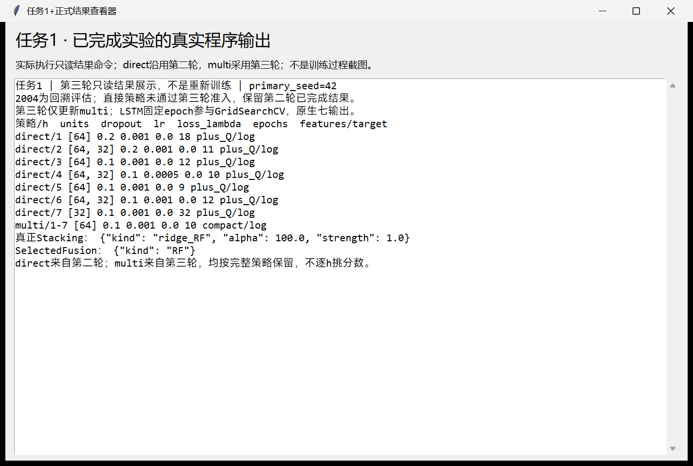

[任务1+八组参数真实程序窗口截图](figures/任务1+正式结果程序窗口截图.png)

### 任务1及3+原生多输出实现

SequenceNet最终Linear直接输出7列，单次前向返回(N,7)。ANN和RF直接fit二维目标，未使用MultiOutputRegressor。多输出Stacking是21列基模型预测到7列目标的单个原生Ridge。Ridge并不因此自动学习目标协方差。

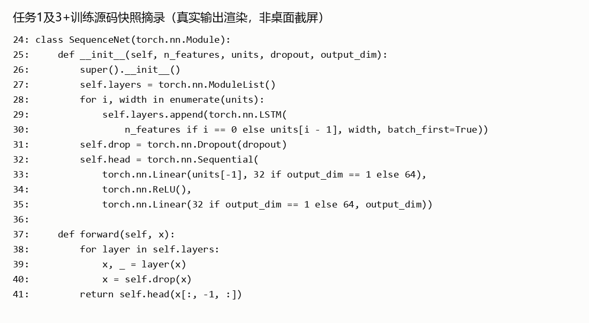

[任务1及3+原生网络源码摘录（文字渲染，非桌面截图）](figures/任务1及3+原生七输出网络证据.png)

## 子任务2：LSTM直接策略1~7天预测精度

来源：formal_20261031_v2。主表固定seed42，每行359个相同测试起报点；负R²保留，本组预测负值数为0。

| h | R² | RMSE | MAE | n |
| --- | --- | --- | --- | --- |
| 1 | 0.4889 | 601.9554 | 213.6995 | 359 |
| 2 | 0.1357 | 785.8383 | 366.5432 | 359 |
| 3 | -0.1570 | 909.9445 | 461.9354 | 359 |
| 4 | -0.0097 | 850.4085 | 410.8970 | 359 |
| 5 | -0.1950 | 925.2992 | 493.1826 | 359 |
| 6 | 0.0078 | 843.2173 | 461.9827 | 359 |
| 7 | 0.0602 | 820.7061 | 412.0326 | 359 |

[任务2+逐h完整结果](data/任务2+LSTM直接策略指标.csv)

| h | R2均值±s | RMSE均值±s | MAE均值±s |
| --- | --- | --- | --- |
| 1 | 0.4733 ± 0.0142 | 611.0226 ± 8.2752 | 227.1565 ± 11.8907 |
| 2 | 0.1855 ± 0.0461 | 762.6544 ± 21.5100 | 335.9542 ± 26.6949 |
| 3 | -0.0194 ± 0.1308 | 852.9760 ± 54.6157 | 425.2792 ± 37.9199 |
| 4 | 0.0030 ± 0.0123 | 845.0195 ± 5.2110 | 421.2587 ± 10.8947 |
| 5 | -0.0627 ± 0.1152 | 871.7473 ± 46.6482 | 439.7662 ± 46.3139 |
| 6 | -0.0413 ± 0.0693 | 863.5196 ± 28.5096 | 443.9267 ± 30.8244 |
| 7 | 0.0317 ± 0.0282 | 833.0127 ± 12.1385 | 422.1414 ± 19.0625 |

三seed为相同年份与配置下随机性复核，s为样本标准差ddof=1，不是独立年份置信区间，未按测试结果挑选seed。

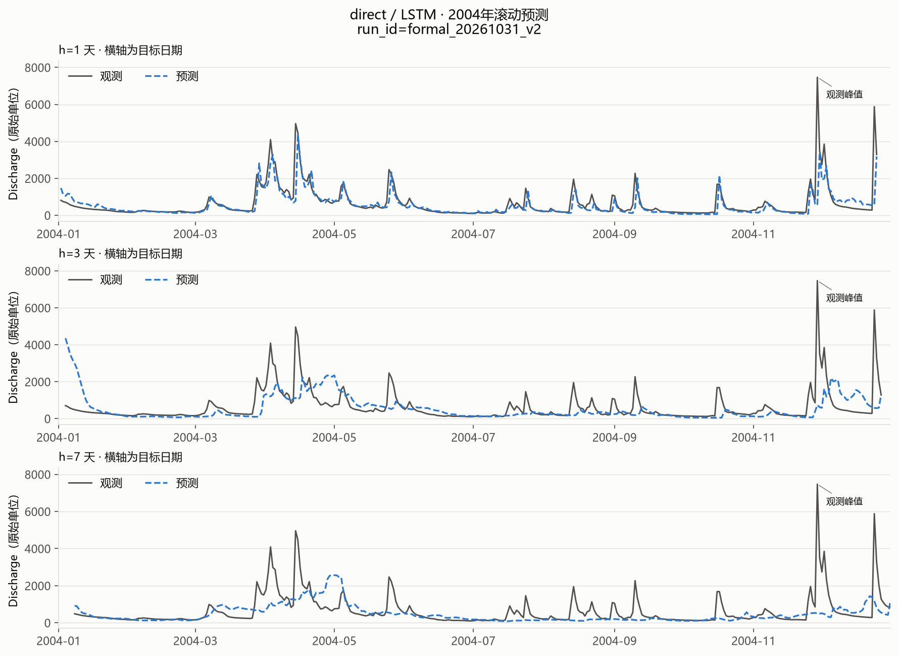

[任务2+h1/h3/h7过程线（目标日期）](figures/任务2+LSTM直接策略过程线.png)

[任务2+真实结果程序窗口截图](figures/任务2+正式结果程序窗口截图.png)

## 子任务3：LSTM多输出策略1~7天预测精度

来源：formal_20261101_v3_stage_d。主表固定seed42，每行359个相同测试起报点；负R²保留，本组预测负值数为0。

| h | R² | RMSE | MAE | n |
| --- | --- | --- | --- | --- |
| 1 | 0.3487 | 679.5188 | 305.9788 | 359 |
| 2 | 0.1914 | 760.0963 | 352.3236 | 359 |
| 3 | 0.1311 | 788.5493 | 372.7879 | 359 |
| 4 | 0.0860 | 809.0942 | 391.5634 | 359 |
| 5 | 0.0345 | 831.7474 | 408.8615 | 359 |
| 6 | 0.0156 | 839.8903 | 418.1652 | 359 |
| 7 | -0.0012 | 847.1064 | 425.5437 | 359 |

[任务3+逐h完整结果](data/任务3+LSTM多输出策略指标.csv)

| h | R2均值±s | RMSE均值±s | MAE均值±s |
| --- | --- | --- | --- |
| 1 | 0.3512 ± 0.0053 | 678.2052 ± 2.7958 | 305.4406 ± 0.4662 |
| 2 | 0.1999 ± 0.0075 | 756.0939 ± 3.5386 | 347.6991 ± 4.1642 |
| 3 | 0.1282 ± 0.0040 | 789.8887 ± 1.8048 | 373.8924 ± 4.0847 |
| 4 | 0.0792 ± 0.0084 | 812.0869 ± 3.7005 | 392.3881 ± 1.3505 |
| 5 | 0.0357 ± 0.0110 | 831.2217 ± 4.7572 | 406.6778 ± 4.7052 |
| 6 | 0.0137 ± 0.0105 | 840.6888 ± 4.4656 | 415.9474 ± 5.1298 |
| 7 | -0.0034 ± 0.0078 | 848.0185 ± 3.2732 | 425.6798 ± 3.6604 |

三seed为相同年份与配置下随机性复核，s为样本标准差ddof=1，不是独立年份置信区间，未按测试结果挑选seed。

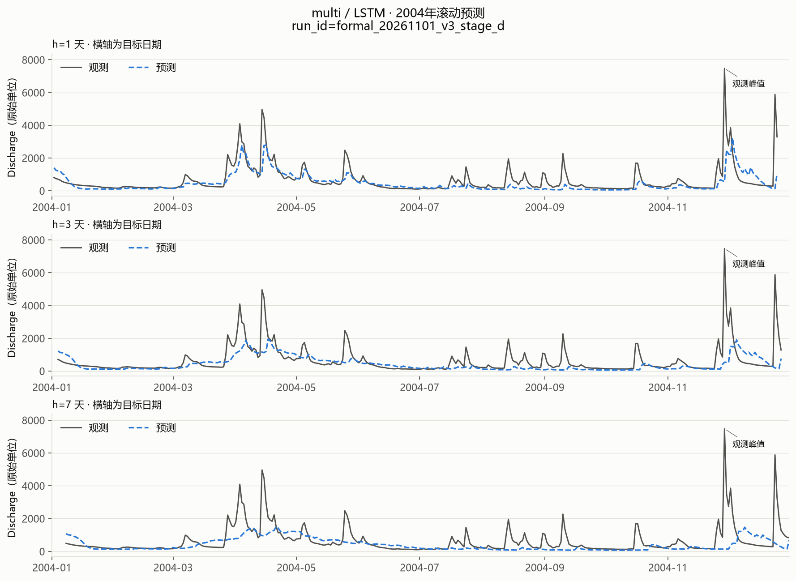

[任务3+h1/h3/h7过程线（目标日期）](figures/任务3+LSTM多输出策略过程线.png)

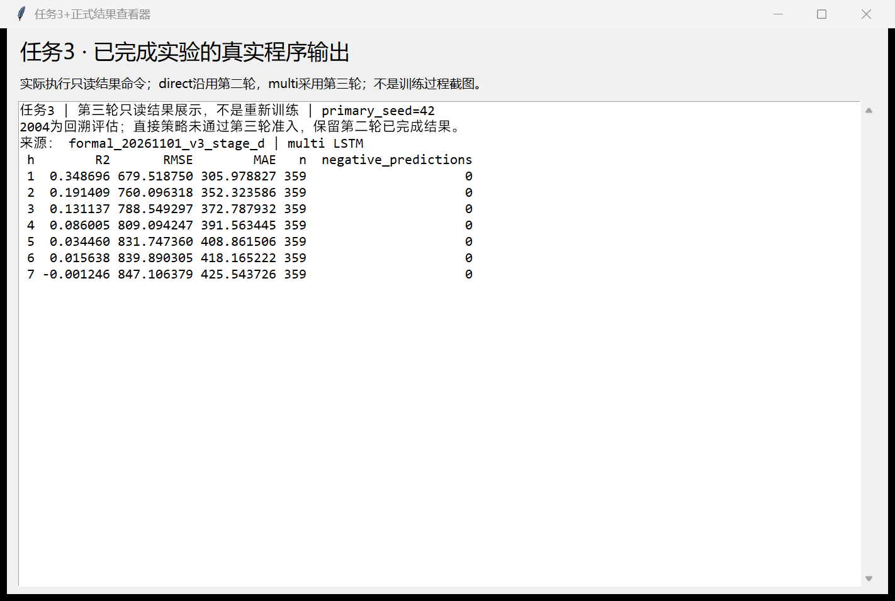

[任务3+真实结果程序窗口截图](figures/任务3+正式结果程序窗口截图.png)

## 任务4至7+已实现集成方法

Mean严格在原尺度计算(ANN+RF+LSTM)/3。直接Stacking每h用同h三模型预测拟合7个元模型，第二轮raw/log×alpha1/10/100/1000在净化前向OOF中选择；各seed独立选元层。多输出Stacking按ANN h1—7、RF h1—7、LSTM h1—7组成21列，经StandardScaler后拟合原生七输出Ridge(alpha100)，在907条OOF上重训。alpha100是已冻结诊断配置，不声称它由第三轮GridSearchCV选出。原尺度Ridge不裁剪负预测。

第三轮另验证RF、Mean、三权重非负和为1凸融合和向RF收缩的Ridge。部分收缩候选通过平均相对比值门槛，但部署选择按各季度原尺度RMSE的算术平均，RF为635.2039，最佳合格候选636.7351，故SelectedFusion选择RF。二者不可混淆：任务7报告真正Stacking，RF退路只作附加部署结果，不能声称融合提升。

[任务5+第二轮元层参数](artifacts/任务5+第二轮元层参数.json)

[任务7+第三轮元层前向验证](data/任务7+第三轮元层前向验证.csv)

[任务7+真实Stacking与部署选择](artifacts/任务7+真实Stacking与部署选择.json)

## 子任务4：直接策略简单平均1~7天预测精度

来源：formal_20261031_v2。主表固定seed42，每行359个相同测试起报点；负R²保留，本组预测负值数为0。

| h | R² | RMSE | MAE | n |
| --- | --- | --- | --- | --- |
| 1 | 0.5071 | 591.1307 | 198.2557 | 359 |
| 2 | 0.2084 | 752.0567 | 354.4389 | 359 |
| 3 | 0.0654 | 817.8157 | 428.1294 | 359 |
| 4 | 0.0549 | 822.7632 | 435.3790 | 359 |
| 5 | 0.0259 | 835.4335 | 440.3428 | 359 |
| 6 | 0.0163 | 839.6238 | 454.2590 | 359 |
| 7 | 0.0693 | 816.7286 | 421.4209 | 359 |

[任务4+逐h完整结果](data/任务4+简单平均直接策略指标.csv)

| h | R2均值±s | RMSE均值±s | MAE均值±s |
| --- | --- | --- | --- |
| 1 | 0.5055 ± 0.0082 | 592.0539 ± 4.9336 | 204.0010 ± 7.8438 |
| 2 | 0.2389 ± 0.0277 | 737.3452 ± 13.3682 | 339.7099 ± 12.8194 |
| 3 | 0.1144 ± 0.0438 | 795.9417 ± 19.5990 | 412.5241 ± 13.9844 |
| 4 | 0.0562 ± 0.0194 | 822.1677 ± 8.4498 | 438.5464 ± 11.0063 |
| 5 | -0.0582 ± 0.1088 | 870.0068 ± 44.2850 | 458.4680 ± 23.1609 |
| 6 | 0.0073 ± 0.0218 | 843.4029 ± 9.2510 | 450.9919 ± 9.7662 |
| 7 | 0.0497 ± 0.0179 | 825.2659 ± 7.7919 | 427.0869 ± 6.4379 |

三seed为相同年份与配置下随机性复核，s为样本标准差ddof=1，不是独立年份置信区间，未按测试结果挑选seed。

| h | 最低RMSE基模型 | 基模型RMSE | 集成RMSE | 变化% |
| --- | --- | --- | --- | --- |
| 1 | RF | 593.0151 | 591.1307 | -0.3178 |
| 2 | RF | 722.5671 | 752.0567 | 4.0812 |
| 3 | RF | 755.2046 | 817.8157 | 8.2906 |
| 4 | RF | 789.6234 | 822.7632 | 4.1969 |
| 5 | ANN | 827.8512 | 835.4335 | 0.9159 |
| 6 | RF | 820.2084 | 839.6238 | 2.3671 |
| 7 | LSTM | 820.7061 | 816.7286 | -0.4846 |

本集成在2/7个预见期优于同h最佳基模型。逐h最佳只是事后诊断参照，不是一套已部署选择器。

[任务4+集成相对基模型数值表](data/任务4+集成相对基模型.csv)

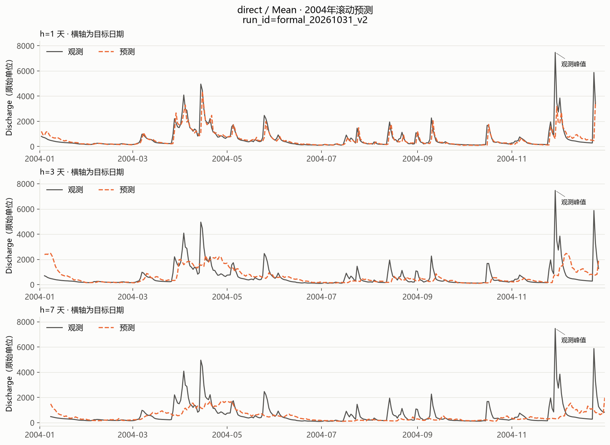

[任务4+h1/h3/h7过程线（目标日期）](figures/任务4+简单平均直接策略过程线.png)

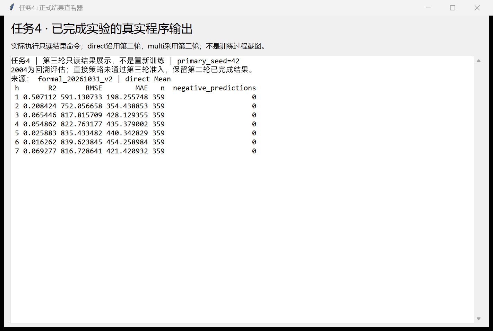

[任务4+真实结果程序窗口截图](figures/任务4+正式结果程序窗口截图.png)

## 子任务5：直接策略Stacking 1~7天预测精度

来源：formal_20261031_v2。主表固定seed42，每行359个相同测试起报点；负R²保留，本组预测负值数为0。

| h | R² | RMSE | MAE | n |
| --- | --- | --- | --- | --- |
| 1 | 0.5051 | 592.3545 | 214.3997 | 359 |
| 2 | 0.2303 | 741.5734 | 385.6181 | 359 |
| 3 | 0.0402 | 828.8009 | 539.1587 | 359 |
| 4 | -0.0699 | 875.3904 | 580.3989 | 359 |
| 5 | 0.0338 | 832.0397 | 552.3373 | 359 |
| 6 | 0.0344 | 831.8515 | 524.3041 | 359 |
| 7 | 0.1033 | 801.6462 | 494.1989 | 359 |

[任务5+逐h完整结果](data/任务5+Stacking直接策略指标.csv)

| h | R2均值±s | RMSE均值±s | MAE均值±s |
| --- | --- | --- | --- |
| 1 | 0.5071 ± 0.0149 | 591.0833 ± 8.9652 | 215.8588 ± 10.5029 |
| 2 | 0.1881 ± 0.0582 | 761.3149 ± 27.0502 | 407.1581 ± 26.3937 |
| 3 | 0.0741 ± 0.0570 | 813.7615 ± 25.2928 | 516.6838 ± 21.8284 |
| 4 | 0.0287 ± 0.1089 | 833.1641 ± 47.1545 | 537.2304 ± 49.8717 |
| 5 | 0.0157 ± 0.0892 | 839.2136 ± 37.8262 | 540.0399 ± 30.0825 |
| 6 | 0.0599 ± 0.0240 | 820.7545 ± 10.4805 | 513.0496 ± 11.0718 |
| 7 | 0.0945 ± 0.0102 | 805.5802 ± 4.5548 | 496.9793 ± 2.7556 |

三seed为相同年份与配置下随机性复核，s为样本标准差ddof=1，不是独立年份置信区间，未按测试结果挑选seed。

| h | 最低RMSE基模型 | 基模型RMSE | 集成RMSE | 变化% |
| --- | --- | --- | --- | --- |
| 1 | RF | 593.0151 | 592.3545 | -0.1114 |
| 2 | RF | 722.5671 | 741.5734 | 2.6304 |
| 3 | RF | 755.2046 | 828.8009 | 9.7452 |
| 4 | RF | 789.6234 | 875.3904 | 10.8618 |
| 5 | ANN | 827.8512 | 832.0397 | 0.5059 |
| 6 | RF | 820.2084 | 831.8515 | 1.4195 |
| 7 | LSTM | 820.7061 | 801.6462 | -2.3224 |

本集成在2/7个预见期优于同h最佳基模型。逐h最佳只是事后诊断参照，不是一套已部署选择器。

[任务5+集成相对基模型数值表](data/任务5+集成相对基模型.csv)

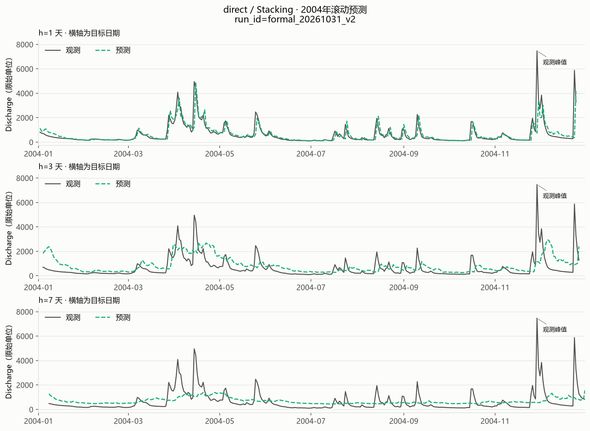

[任务5+h1/h3/h7过程线（目标日期）](figures/任务5+Stacking直接策略过程线.png)

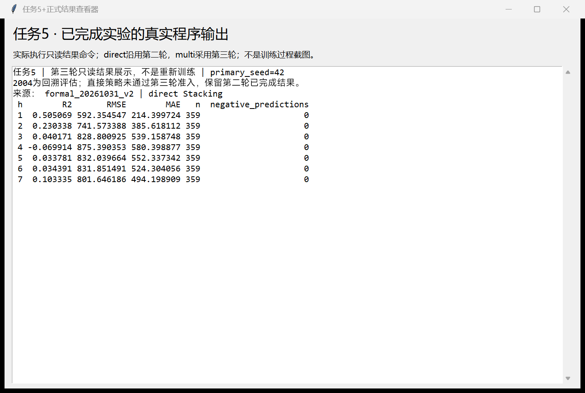

[任务5+真实结果程序窗口截图](figures/任务5+正式结果程序窗口截图.png)

## 子任务6：多输出策略简单平均1~7天预测精度

来源：formal_20261101_v3_stage_d。主表固定seed42，每行359个相同测试起报点；负R²保留，本组预测负值数为0。

| h | R² | RMSE | MAE | n |
| --- | --- | --- | --- | --- |
| 1 | 0.4397 | 630.2538 | 235.9608 | 359 |
| 2 | 0.2308 | 741.3701 | 318.7038 | 359 |
| 3 | 0.1743 | 768.7043 | 353.8845 | 359 |
| 4 | 0.1014 | 802.2691 | 389.1491 | 359 |
| 5 | 0.0583 | 821.4061 | 407.6996 | 359 |
| 6 | 0.0153 | 840.0178 | 428.4264 | 359 |
| 7 | -0.0010 | 846.9891 | 445.1161 | 359 |

[任务6+逐h完整结果](data/任务6+简单平均多输出策略指标.csv)

| h | R2均值±s | RMSE均值±s | MAE均值±s |
| --- | --- | --- | --- |
| 1 | 0.4535 ± 0.0119 | 622.4272 ± 6.7781 | 229.0688 ± 6.6308 |
| 2 | 0.2591 ± 0.0246 | 727.5020 ± 12.0366 | 308.4243 ± 8.9298 |
| 3 | 0.1688 ± 0.0287 | 771.1940 ± 13.2790 | 360.3720 ± 10.4442 |
| 4 | 0.1009 ± 0.0280 | 802.3962 ± 12.4924 | 393.5464 ± 10.6726 |
| 5 | 0.0297 ± 0.0611 | 833.5354 ± 26.0288 | 421.4665 ± 23.1245 |
| 6 | 0.0049 ± 0.0226 | 844.4326 ± 9.5698 | 433.3861 ± 11.1557 |
| 7 | 0.0020 ± 0.0071 | 845.7282 ± 3.0031 | 441.4928 ± 4.4894 |

三seed为相同年份与配置下随机性复核，s为样本标准差ddof=1，不是独立年份置信区间，未按测试结果挑选seed。

| h | 最低RMSE基模型 | 基模型RMSE | 集成RMSE | 变化% |
| --- | --- | --- | --- | --- |
| 1 | RF | 611.9780 | 630.2538 | 2.9864 |
| 2 | RF | 705.2936 | 741.3701 | 5.1151 |
| 3 | RF | 748.7668 | 768.7043 | 2.6627 |
| 4 | RF | 777.8044 | 802.2691 | 3.1453 |
| 5 | RF | 804.4202 | 821.4061 | 2.1116 |
| 6 | RF | 819.3181 | 840.0178 | 2.5265 |
| 7 | RF | 832.0889 | 846.9891 | 1.7907 |

本集成在0/7个预见期优于同h最佳基模型。逐h最佳只是事后诊断参照，不是一套已部署选择器。

[任务6+集成相对基模型数值表](data/任务6+集成相对基模型.csv)

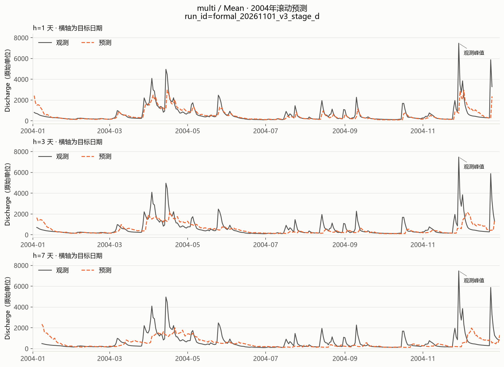

[任务6+h1/h3/h7过程线（目标日期）](figures/任务6+简单平均多输出策略过程线.png)

[任务6+真实结果程序窗口截图](figures/任务6+正式结果程序窗口截图.png)

## 子任务7：多输出策略Stacking 1~7天预测精度

来源：formal_20261101_v3_stage_d。主表固定seed42，每行359个相同测试起报点；负R²保留，本组预测负值数为0。

| h | R² | RMSE | MAE | n |
| --- | --- | --- | --- | --- |
| 1 | 0.4452 | 627.1650 | 277.7039 | 359 |
| 2 | 0.2734 | 720.5361 | 369.8963 | 359 |
| 3 | 0.1968 | 758.1824 | 420.9169 | 359 |
| 4 | 0.1414 | 784.2099 | 451.4149 | 359 |
| 5 | 0.0688 | 816.8325 | 472.0889 | 359 |
| 6 | 0.0499 | 825.1272 | 479.4392 | 359 |
| 7 | 0.0026 | 845.4982 | 489.6515 | 359 |

[任务7+逐h完整结果](data/任务7+Stacking多输出策略指标.csv)

| h | R2均值±s | RMSE均值±s | MAE均值±s |
| --- | --- | --- | --- |
| 1 | 0.4572 ± 0.0107 | 620.3319 ± 6.1042 | 270.7997 ± 6.9064 |
| 2 | 0.2801 ± 0.0066 | 717.1706 ± 3.2622 | 368.6100 ± 6.4776 |
| 3 | 0.2091 ± 0.0205 | 752.3069 ± 9.8007 | 421.7600 ± 15.4239 |
| 4 | 0.1584 ± 0.0300 | 776.2932 ± 13.9203 | 448.6799 ± 22.0135 |
| 5 | 0.0658 ± 0.0521 | 817.9164 ± 22.8001 | 480.1769 ± 27.0557 |
| 6 | 0.0218 ± 0.0692 | 836.9066 ± 29.3862 | 498.5782 ± 32.5993 |
| 7 | -0.0213 ± 0.0332 | 855.4799 ± 13.8584 | 514.1505 ± 25.5558 |

三seed为相同年份与配置下随机性复核，s为样本标准差ddof=1，不是独立年份置信区间，未按测试结果挑选seed。

| h | 最低RMSE基模型 | 基模型RMSE | 集成RMSE | 变化% |
| --- | --- | --- | --- | --- |
| 1 | RF | 611.9780 | 627.1650 | 2.4816 |
| 2 | RF | 705.2936 | 720.5361 | 2.1612 |
| 3 | RF | 748.7668 | 758.1824 | 1.2575 |
| 4 | RF | 777.8044 | 784.2099 | 0.8235 |
| 5 | RF | 804.4202 | 816.8325 | 1.5430 |
| 6 | RF | 819.3181 | 825.1272 | 0.7090 |
| 7 | RF | 832.0889 | 845.4982 | 1.6115 |

本集成在0/7个预见期优于同h最佳基模型。逐h最佳只是事后诊断参照，不是一套已部署选择器。

[任务7+集成相对基模型数值表](data/任务7+集成相对基模型.csv)

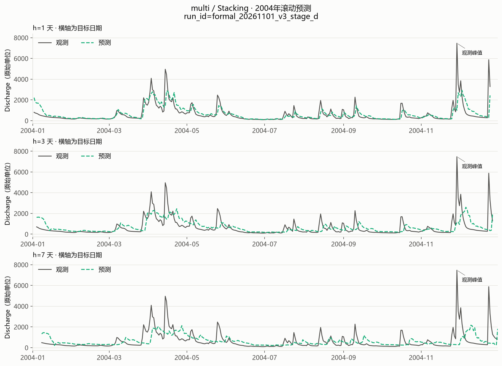

[任务7+h1/h3/h7过程线（目标日期）](figures/任务7+Stacking多输出策略过程线.png)

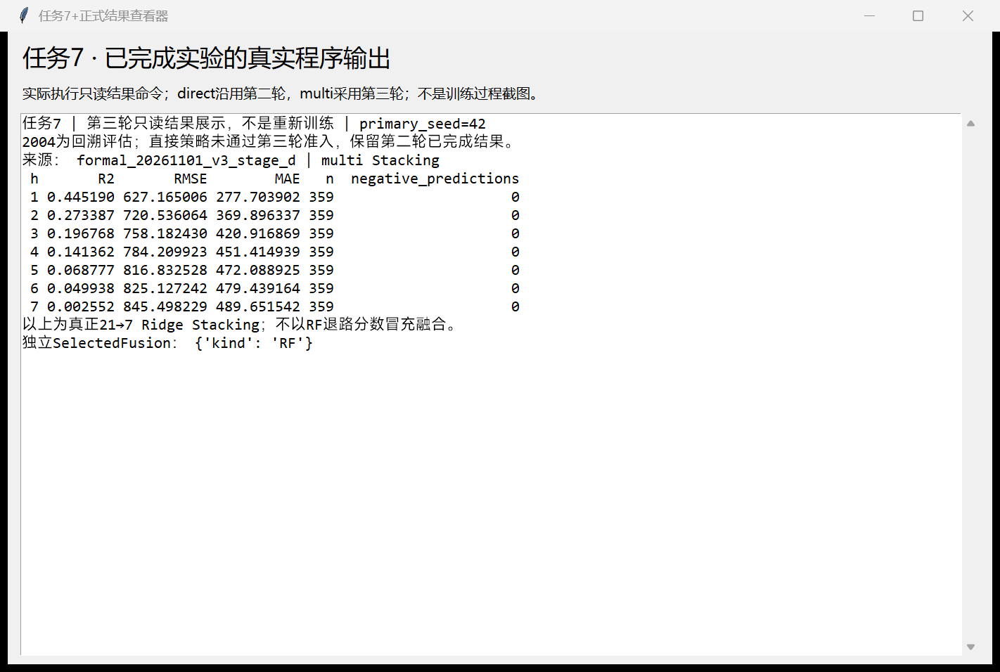

[任务7+真实结果程序窗口截图](figures/任务7+正式结果程序窗口截图.png)

## 任务2至7+总体对照与误差分析

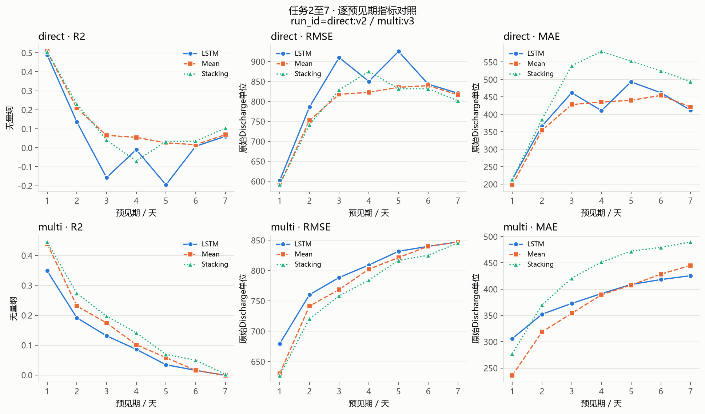

[任务2至7+逐预见期精度对照](figures/任务2至7+当前逐预见期指标.png)

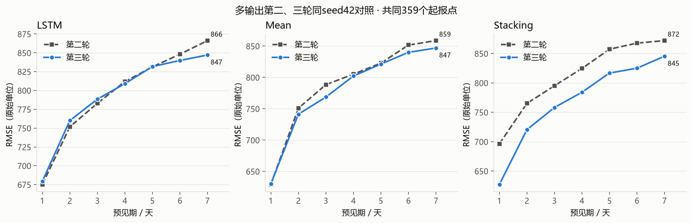

[任务3及6及7+第二三轮同seed42对照](figures/任务3及6及7+第二三轮RMSE对照.png)

| strategy | model | RMSE_current | RMSE_v2 | RMSE变化% |
| --- | --- | --- | --- | --- |
| direct | ANN | 835.1610 | 835.1610 | 0.0000 |
| direct | LSTM | 819.6242 | 819.6242 | 0.0000 |
| direct | Mean | 782.2217 | 782.2217 | 0.0000 |
| direct | RF | 765.0755 | 765.0755 | 0.0000 |
| direct | Stacking | 786.2367 | 786.2367 | 0.0000 |
| multi | ANN | 854.1012 | 880.4018 | -2.9873 |
| multi | LSTM | 793.7147 | 795.3680 | -0.2079 |
| multi | Mean | 778.7158 | 786.7351 | -1.0193 |
| multi | RF | 757.0957 | 756.1897 | 0.1198 |
| multi | Stacking | 768.2216 | 811.2634 | -5.3055 |

[任务2至7+与第二轮逐h完整对照](data/任务2至7+与第二轮逐h对照.csv)

[任务2至7+第一轮完整指标](data/任务2至7+第一轮同口径指标.csv)

第三轮多输出seed42：LSTM七步平均RMSE仅下降0.21%，h1从675.1497退化为679.5188（R²从0.3570降至0.3487）；Mean下降1.02%，Stacking下降5.31%。三seed各自平均七步再跨seed平均，RMSE分别下降1.00%、0.73%、3.14%。不能把开发期相对A0的5.92%当作测试提升。

对第一轮的比较也不支持全面领先：第一轮多输出Mean为767.4847，仍低于本版778.7158；第一轮Stacking767.4846也略低于本版768.2216。Stacking主要修复第二轮校准退化，当前主seed仍差于RF757.0957，MAE423.0160也高于RF357.6963。ANN主seed七步RMSE854.1012，但三seed波动明显，融合不保证增益。

| h | R2 | RMSE | MAE |
| --- | --- | --- | --- |
| 1 | 0.3988 | 652.8319 | 214.4568 |
| 2 | 0.0603 | 819.4180 | 333.9638 |
| 3 | -0.0533 | 868.2383 | 403.7827 |
| 4 | -0.2447 | 944.1941 | 458.1811 |
| 5 | -0.3992 | 1001.2553 | 494.0056 |
| 6 | -0.4778 | 1029.0756 | 521.8830 |
| 7 | -0.5815 | 1064.6259 | 538.0864 |

持久性基线为各h均预测起报日Q，完整基线还含训练均值、季节均值、7日Q的Ridge。基线与本版使用相同359起报点，可作技能参照；不能只用复杂模型间排名证明有效。远期缺少未来降雨信息，洪峰幅度和时序偏差仍明显。

[任务2至7+朴素基线完整指标](data/任务2至7+同样本朴素基线指标.csv)

## 任务1至7+完成性、来源及交付核验

第二轮完整运行约92分钟；第三轮A约6.54分钟、B约25.94分钟、C约17.02分钟，阶段C821次基模型fit全部保存恢复通过。训练时长不是精度证据；本版不承诺不存在于实测结果中的提升。CPU/PyTorch2.6.0+cpu，包版本和数据SHA256见来源附件。

直接策略保留第二轮结果不等于第三轮重新完成所有任务；多输出第三轮独立完成。2004的359个共同起报点、目标日期和真值一致，Mean与两种元层由落盘预测重建。源码、模型和历史保留在本地运行目录；交付包只包含报告直接引用的最终附件，不含训练计划、源码、缓存或日志。

七张程序图来自实际执行只读结果命令并以Windows PrintWindow捕获本程序窗口，不冒充训练过程截图。所有图内嵌且附原图链接、完整数值表。自动检查Word结构、数值、相对链接、ZIP完整性；未进行Word/WPS桌面逐页检查，因此不声称完成桌面分页视觉验收。

[任务1至7+主seed42完整指标与来源](data/任务1至7+主seed42完整指标与来源.csv)

[任务1至7+三seed完整指标与来源](data/任务1至7+三seed完整指标与来源.csv)

[任务1至7+主seed42逐日预测与来源](data/任务1至7+主seed42逐日预测与来源.csv)

[任务1至7+三seed逐日预测与来源](data/任务1至7+三seed逐日预测与来源.csv)

[任务1+八组最终LSTM参数](data/任务1+八组最终LSTM参数.csv)

[任务2至7+三seed均值与样本标准差](data/任务2至7+三seed均值与样本标准差.csv)

[任务1+第三轮完整网格候选](data/任务1+第三轮完整网格候选.csv)

[任务1及7+第三轮内层时间净化审计](data/任务1及7+第三轮内层时间净化审计.csv)

[任务2及4及5+第二轮运行来源](artifacts/任务2及4及5+第二轮运行来源.json)

[任务2及4及5+第二轮核验](artifacts/任务2及4及5+第二轮核验.json)

[任务1+第二轮完整基模型参数](artifacts/任务1+第二轮完整基模型参数.json)

[任务5+第二轮元层参数](artifacts/任务5+第二轮元层参数.json)

[任务2及4及5+第二轮冻结记录](artifacts/任务2及4及5+第二轮冻结记录.json)

[任务3及6及7+第三轮训练来源](artifacts/任务3及6及7+第三轮训练来源.json)

[任务3及6及7+第三轮训练核验](artifacts/任务3及6及7+第三轮训练核验.json)

[任务3及6及7+第三轮最终参数](artifacts/任务3及6及7+第三轮最终参数.json)

[任务7+真实Stacking与部署选择](artifacts/任务7+真实Stacking与部署选择.json)

[任务3及6及7+第三轮评估来源](artifacts/任务3及6及7+第三轮评估来源.json)

[任务3及6及7+第三轮评估核验](artifacts/任务3及6及7+第三轮评估核验.json)

[任务3及6及7+测试前模型校验摘要](artifacts/任务3及6及7+测试前模型校验摘要.json)

[任务1至7+样本与特征摘要](artifacts/任务1至7+样本与特征摘要.json)

[任务1至7+第三次阶段验收说明原文](artifacts/任务1至7+第三次阶段验收说明原文.docx)

[任务1+第二轮完整网格候选](data/任务1+第二轮完整网格候选.csv)

[任务7+第三轮季度OOF划分](data/任务7+第三轮季度OOF划分.csv)

[任务7+第三轮元层前向验证](data/任务7+第三轮元层前向验证.csv)

[任务7+第三轮三seed因果OOF预测](data/任务7+第三轮三seed因果OOF预测.csv)

[任务5+第二轮三seed因果OOF预测](data/任务5+第二轮三seed因果OOF预测.csv)

[任务2至7+同样本朴素基线指标](data/任务2至7+同样本朴素基线指标.csv)
