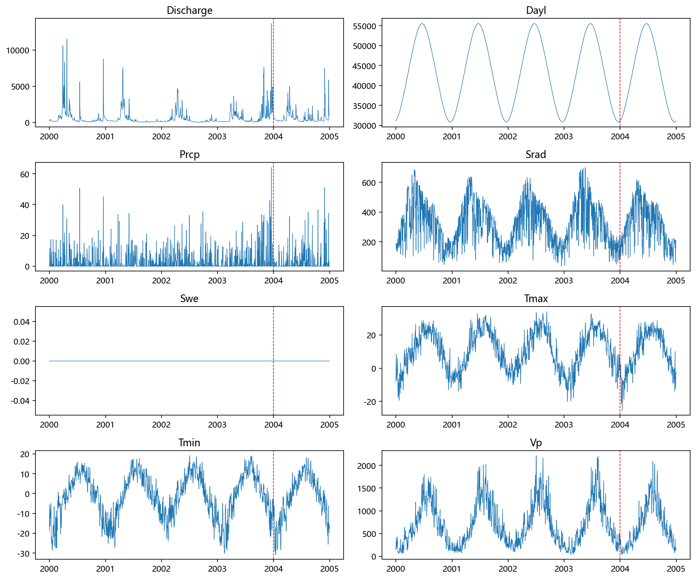
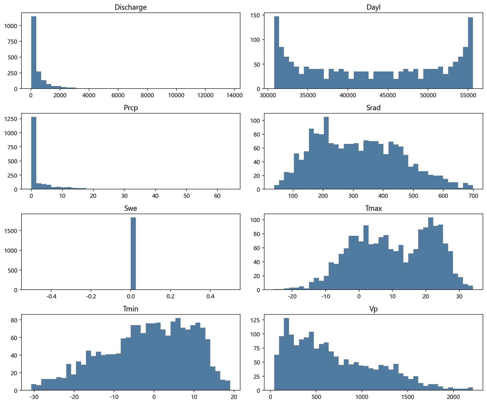
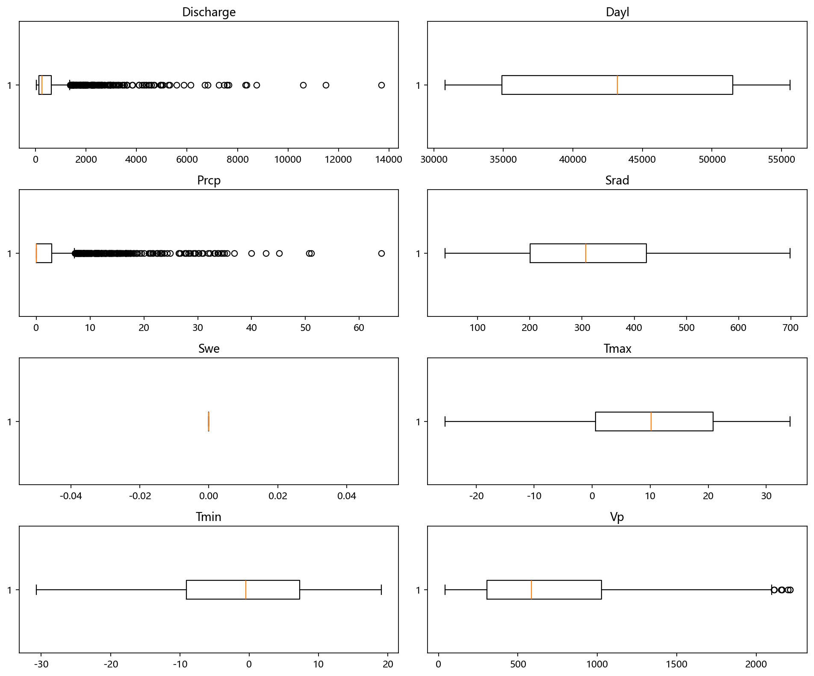
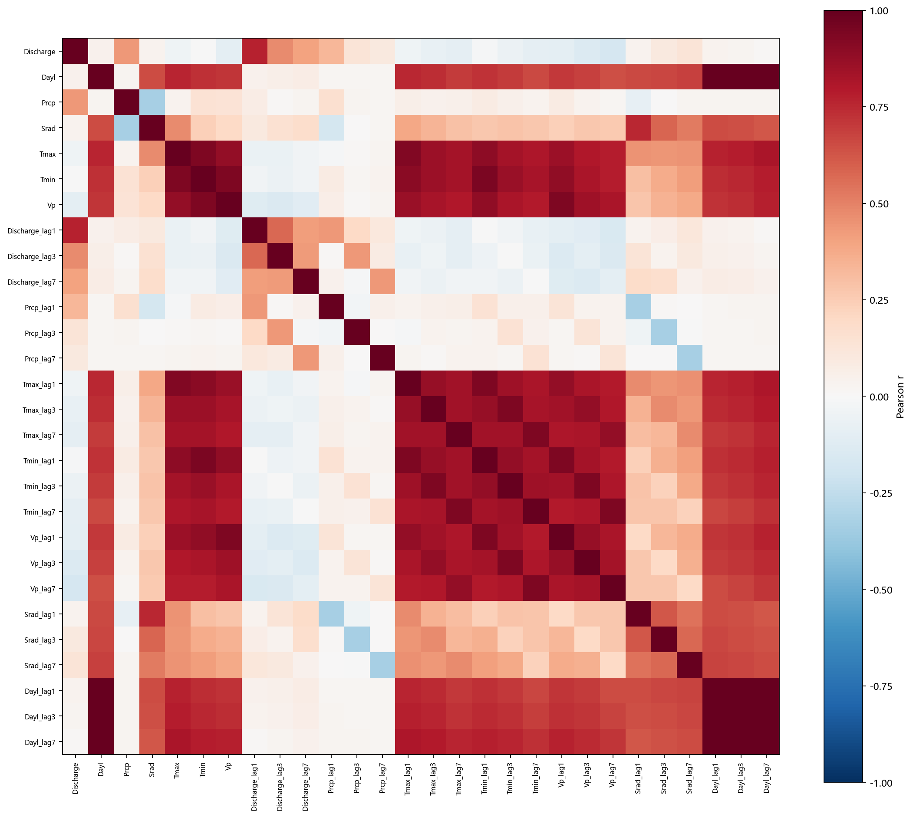
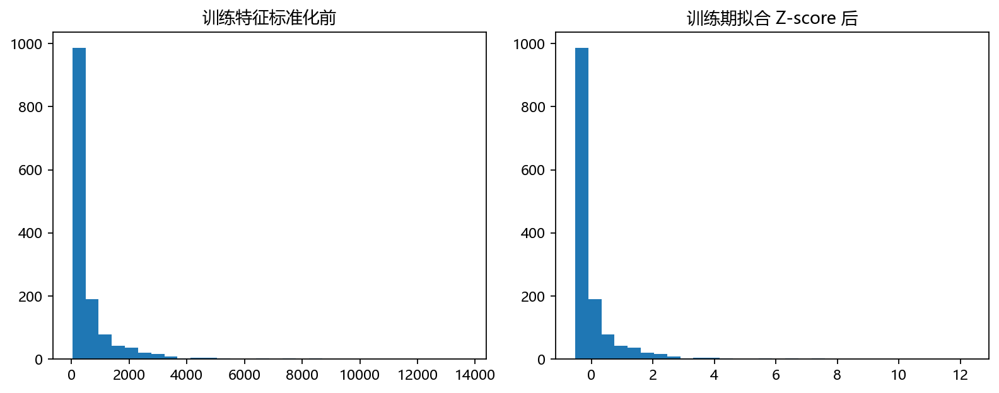

# 任务1至8+第1次阶段验收记录

生成日期：2026-11-05；第1次修改版。来源运行：`formal_20261105_clean`。
数据 SHA-256：`ab09410b23118510bb4e8787a62b97693336a1c46477a01329f587c64bc57151`。
原始 CSV 未改动。模型仅在 2000—2003 年训练；所有折内选择和缩放使用本折训练数据。
正式回溯测试统一为 359 个预测原点（2004-01-01 至 2004-12-24），标签为 t+1…t+7。
三份验收记录来自同一冻结运行；R²不是相关系数的平方。

## 任务1+英文字段中文含义

逐项说明日期、径流及七个气象字段。Dayl 是日长，不是实测日照小时数；流量单位未由教师资料明确，不擅自换算。

[英文字段中文含义](data/任务1+英文字段中文含义.csv)

| field | 中文含义 | 单位 | 说明 |
|---|---|---|---|
| Date | 日期 | 年-月-日 | 教师 CSV 日期列 |
| Discharge | 径流流量 | 原始流量单位（教师资料未明确，未换算） | 预测目标 |
| Dayl | 日长 | s/day | 太阳位于地平线以上的时长，不等同实测日照时数 |
| Prcp | 降水量 | mm/day | 各种形态降水的日总水当量 |
| Srad | 短波辐射 | W/m² | 日间平均入射短波辐射通量密度 |
| Swe | 雪水当量 | kg/m² | 积雪所含水量；本站五年全为零 |
| Tmax | 日最高气温 | ℃ | 日最高近地面气温 |
| Tmin | 日最低气温 | ℃ | 日最低近地面气温 |
| Vp | 水汽压 | Pa | 日平均近地面水汽分压 |

## 任务2+全部非日期列时间序列

八个非日期字段全部展示，包括恒零 Swe。红线为训练/测试年份分界。

[打开原图：全部非日期列时间序列](figures/任务2+全部非日期列时间序列.png)

## 任务3+全部非日期列直方图

包含恒零 Swe，避免只画建模所选变量造成缺项。

[打开原图：全部非日期列直方图](figures/任务3+全部非日期列直方图.png)

## 任务4+全部非日期列箱型图

极端观测保留，不删除洪峰。箱型图反映分布和极端值，不把极端值自动判为错误。

[打开原图：全部非日期列箱型图](figures/任务4+全部非日期列箱型图.png)

## 任务5+径流与因子及其滞后相关性

Pearson 热力图包括原径流、径流滞后1/3/7天及各因子的原序列和滞后序列。Swe 为常量，相关系数无定义，未放入热力图。

[打开原图：径流与因子及其滞后相关性](figures/任务5+径流与因子及其滞后相关性.png)

## 任务6+季节月份滞后窗口特征

四季按12—2月冬、3—5月春、6—8月夏、9—11月秋编码；月份正余弦编码。滞后0/1/2/3/7/14/30天，滚动3/7/14天均值、标准差、最大值，均截止预测原点 t。

[季节月份滞后窗口特征](data/任务6+季节月份滞后窗口特征.csv)

[训练期特征明细](data/任务6+训练期特征明细.csv)

## 任务7+Z-score标准化

常见方法包括 Min-Max、Z-score 和鲁棒缩放。本次以各训练折均值和标准差拟合 Z-score，验证/测试只 transform。RF 无需尺度缩放但沿用统一输入，排序不因线性缩放改变。

[打开原图：Z-score标准化](figures/任务7+Z-score标准化.png)

[标准化结果](data/任务7+标准化结果.csv)

## 任务8+训练期互信息特征选择

常见方法分过滤法（相关系数、互信息）、包装法（逐步选择）和嵌入法（树重要性/L1）。本次用训练折目标逐h互信息平均排序，选择候选配置指定数量；不使用测试标签。

[互信息评分与选中特征](data/任务8+互信息评分与选中特征.csv)

[原始数据描述统计](data/任务1+原始数据描述统计.csv)

[Pearson完整系数表](data/任务5+Pearson完整系数表.csv)

[训练期缩放参数](data/任务7+训练期缩放参数.json)

[冻结搜索协议](data/任务1+冻结搜索协议.json)

[运行清单](data/任务1+运行清单.json)

## 结果与边界

同次运行全模型最高 h=1 R²为 0.5103（multi/RF）。未达到约0.8目标，保留真实指标，不继续用2004调参。
2004 已在旧项目被查看，本次称回溯评估，不声称全新盲测。后续h允许自然下降，不对指标曲线强制排序或修饰。
