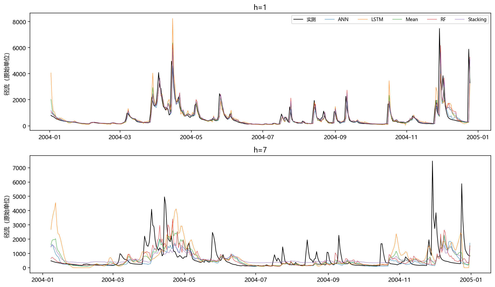
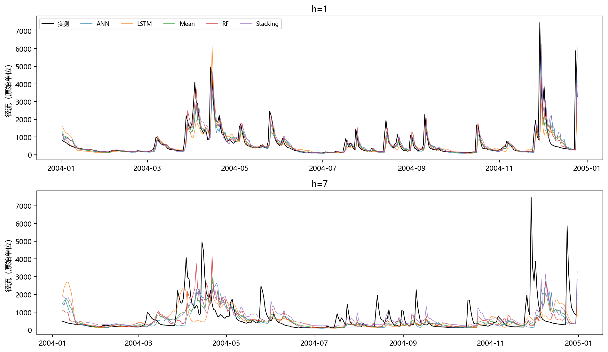

# 任务1至7+第2次阶段验收记录

生成日期：2026-11-05；第1次修改版。来源运行：`formal_20261105_clean`。
数据 SHA-256：`ab09410b23118510bb4e8787a62b97693336a1c46477a01329f587c64bc57151`。
原始 CSV 未改动。模型仅在 2000—2003 年训练；所有折内选择和缩放使用本折训练数据。
正式回溯测试统一为 359 个预测原点（2004-01-01 至 2004-12-24），标签为 t+1…t+7。
三份验收记录来自同一冻结运行；R²不是相关系数的平方。

## 任务1+适用方法

线性回归用于可解释基线；支持向量回归适合非线性小样本；随机森林用树的平均降低方差；ANN 学习非线性特征组合；LSTM 通过循环状态处理历史序列。本实验实现教师指定 ANN/RF/LSTM，另两种仅作方法介绍。

## 任务2+ANN网格搜索

使用 GridSearchCV，训练期 TimeSeriesSplit 两折、gap=7、原始尺度 R²评分。直接策略逐h选参，多输出按七步 R²均值选参。OOF 另做三折外层、每折内独立两折选参，保证参数选择无验证标签泄漏。

| model | cv_R2 | parameters |
|---|---|---|
| direct_ANN_h1 | 0.7076 | {"alpha": 0.1, "hidden": 64, "iterations": 350, "residual": true, "top_k": 24, "transform": "log"} |
| direct_ANN_h2 | 0.4665 | {"alpha": 0.1, "hidden": 64, "iterations": 350, "top_k": 24, "transform": "sqrt"} |
| direct_ANN_h3 | 0.3748 | {"alpha": 0.1, "hidden": 64, "iterations": 350, "residual": true, "top_k": 24, "transform": "log"} |
| direct_ANN_h4 | 0.2903 | {"alpha": 0.1, "hidden": 32, "iterations": 350, "top_k": 24, "transform": "sqrt"} |
| direct_ANN_h5 | 0.2555 | {"alpha": 0.1, "hidden": 32, "iterations": 350, "top_k": 24, "transform": "log"} |
| direct_ANN_h6 | 0.1943 | {"alpha": 0.1, "hidden": 32, "iterations": 350, "top_k": 24, "transform": "log"} |
| direct_ANN_h7 | 0.2184 | {"alpha": 0.1, "hidden": 64, "iterations": 350, "top_k": 24, "transform": "log"} |
| multi_ANN_h7 | 0.3058 | {"alpha": 0.1, "hidden": 32, "iterations": 350, "top_k": 24, "transform": "log"} |

[最终参数与训练期验证分数](data/任务2+最终参数与训练期验证分数.csv)

[完整网格搜索结果](data/任务2+完整网格搜索结果.zip)

## 任务3+ANN direct策略预测精度

| h | R2 | RMSE | MAE | n |
|---|---|---|---|---|
| 1 | 0.4942 | 598.8176 | 182.3914 | 359 |
| 2 | 0.2577 | 728.2681 | 338.4987 | 359 |
| 3 | 0.0682 | 816.6148 | 381.3998 | 359 |
| 4 | 0.1171 | 795.2342 | 412.6272 | 359 |
| 5 | -0.2511 | 946.7878 | 475.8820 | 359 |
| 6 | -0.0021 | 847.4309 | 413.1931 | 359 |
| 7 | -0.0810 | 880.2005 | 444.3475 | 359 |

[ANNdirect指标](data/任务3+ANNdirect指标.csv)

[打开原图：direct实测预测过程线](figures/任务3+direct实测预测过程线.png)

## 任务4+ANN multi策略预测精度

| h | R2 | RMSE | MAE | n |
|---|---|---|---|---|
| 1 | 0.4259 | 637.9762 | 247.8826 | 359 |
| 2 | 0.2629 | 725.6978 | 309.3463 | 359 |
| 3 | 0.1549 | 777.6882 | 363.7698 | 359 |
| 4 | 0.1081 | 799.2502 | 393.4532 | 359 |
| 5 | 0.0484 | 825.7130 | 393.1923 | 359 |
| 6 | -0.0439 | 864.9305 | 449.1616 | 359 |
| 7 | -0.1447 | 905.7787 | 477.3537 | 359 |

[ANNmulti指标](data/任务4+ANNmulti指标.csv)

[打开原图：multi实测预测过程线](figures/任务4+multi实测预测过程线.png)

## 任务5+RF网格搜索

使用 GridSearchCV，训练期 TimeSeriesSplit 两折、gap=7、原始尺度 R²评分。直接策略逐h选参，多输出按七步 R²均值选参。OOF 另做三折外层、每折内独立两折选参，保证参数选择无验证标签泄漏。

| model | cv_R2 | parameters |
|---|---|---|
| direct_RF_h1 | 0.6925 | {"leaf": 1, "residual": true, "top_k": 24, "transform": "log", "trees": 120} |
| direct_RF_h2 | 0.5023 | {"leaf": 1, "residual": true, "top_k": 24, "transform": "log", "trees": 120} |
| direct_RF_h3 | 0.3798 | {"leaf": 1, "residual": true, "top_k": 24, "transform": "log", "trees": 120} |
| direct_RF_h4 | 0.3275 | {"leaf": 1, "residual": true, "top_k": 24, "transform": "log", "trees": 120} |
| direct_RF_h5 | 0.2717 | {"leaf": 1, "residual": true, "top_k": 24, "transform": "log", "trees": 120} |
| direct_RF_h6 | 0.2550 | {"leaf": 1, "residual": true, "top_k": 24, "transform": "log", "trees": 120} |
| direct_RF_h7 | 0.2843 | {"leaf": 1, "residual": true, "top_k": 24, "transform": "log", "trees": 120} |
| multi_RF_h7 | 0.4019 | {"leaf": 1, "residual": true, "top_k": 24, "transform": "log", "trees": 120} |

[最终参数与训练期验证分数](data/任务5+最终参数与训练期验证分数.csv)

[完整网格搜索结果](data/任务5+完整网格搜索结果.zip)

## 任务6+RF direct策略预测精度

| h | R2 | RMSE | MAE | n |
|---|---|---|---|---|
| 1 | 0.4318 | 634.6771 | 220.8107 | 359 |
| 2 | 0.2337 | 739.9311 | 319.0979 | 359 |
| 3 | 0.2498 | 732.7452 | 342.3241 | 359 |
| 4 | 0.1704 | 770.8332 | 370.8884 | 359 |
| 5 | 0.0472 | 826.2252 | 405.2310 | 359 |
| 6 | 0.0183 | 838.7727 | 433.8017 | 359 |
| 7 | 0.0265 | 835.2885 | 428.9357 | 359 |

[RFdirect指标](data/任务6+RFdirect指标.csv)

[打开原图：direct实测预测过程线](figures/任务6+direct实测预测过程线.png)

## 任务7+RF multi策略预测精度

| h | R2 | RMSE | MAE | n |
|---|---|---|---|---|
| 1 | 0.5103 | 589.1977 | 194.9932 | 359 |
| 2 | 0.2962 | 709.1346 | 295.1697 | 359 |
| 3 | 0.2450 | 735.0453 | 346.5209 | 359 |
| 4 | 0.1393 | 785.1518 | 384.9404 | 359 |
| 5 | -0.0013 | 847.0046 | 425.3475 | 359 |
| 6 | -0.0553 | 869.6152 | 448.4284 | 359 |
| 7 | -0.0382 | 862.5863 | 450.3142 | 359 |

[RFmulti指标](data/任务7+RFmulti指标.csv)

[打开原图：multi实测预测过程线](figures/任务7+multi实测预测过程线.png)

[OOF时间边界](data/任务2+OOF时间边界.csv)

[训练期逐折开发指标](data/任务2+训练期逐折开发指标.csv)

[全部正式逐日预测](data/任务3+全部正式逐日预测.csv)

[同样本持续性基线](data/任务3+同样本持续性基线.csv)

[冻结搜索协议](data/任务1+冻结搜索协议.json)

[运行清单](data/任务1+运行清单.json)

## 结果与边界

同次运行全模型最高 h=1 R²为 0.5103（multi/RF）。未达到约0.8目标，保留真实指标，不继续用2004调参。
2004 已在旧项目被查看，本次称回溯评估，不声称全新盲测。后续h允许自然下降，不对指标曲线强制排序或修饰。
