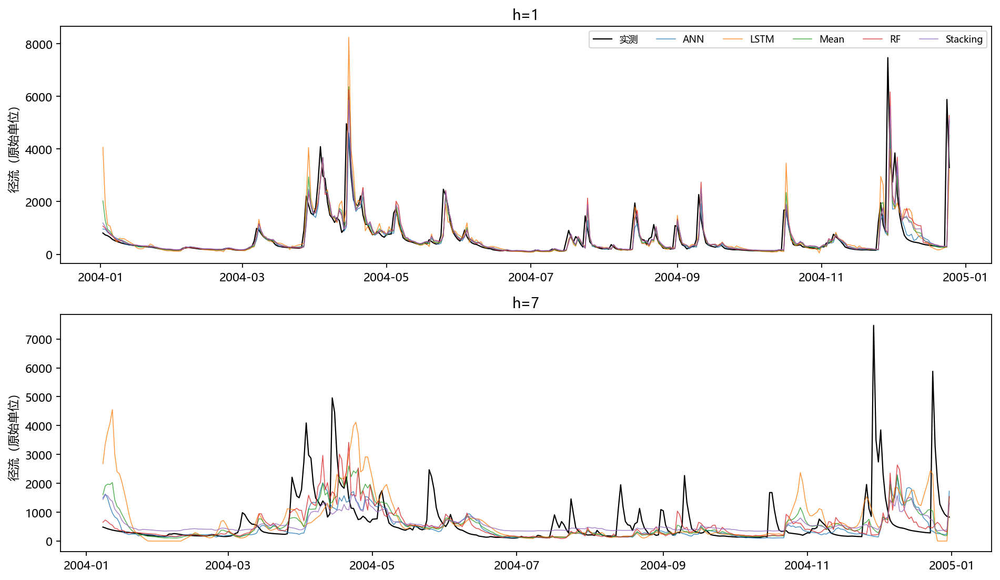
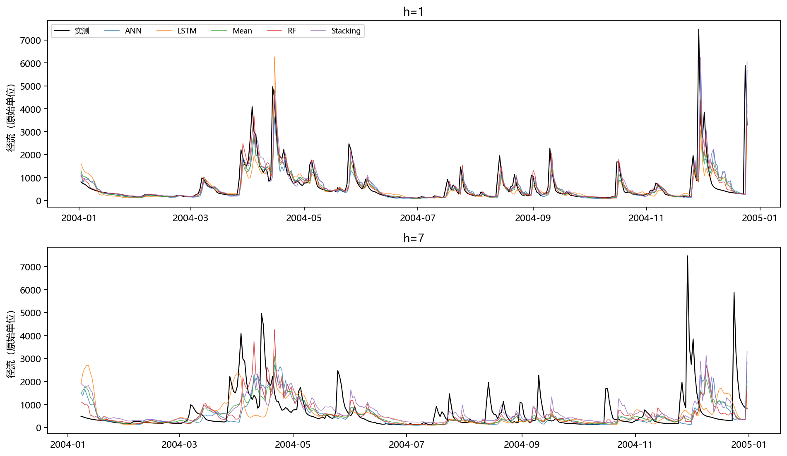

# 任务1至7+第3次阶段验收记录

生成日期：2026-11-05；第1次修改版。来源运行：`formal_20261105_clean`。
数据 SHA-256：`ab09410b23118510bb4e8787a62b97693336a1c46477a01329f587c64bc57151`。
原始 CSV 未改动。模型仅在 2000—2003 年训练；所有折内选择和缩放使用本折训练数据。
正式回溯测试统一为 359 个预测原点（2004-01-01 至 2004-12-24），标签为 t+1…t+7。
三份验收记录来自同一冻结运行；R²不是相关系数的平方。

## 任务1+LSTM网格搜索

使用 GridSearchCV，训练期 TimeSeriesSplit 两折、gap=7、原始尺度 R²评分。直接策略逐h选参，多输出按七步 R²均值选参。OOF 另做三折外层、每折内独立两折选参，保证参数选择无验证标签泄漏。

| model | cv_R2 | parameters |
|---|---|---|
| direct_LSTM_h1 | 0.6747 | {"alpha": 0.1, "epochs": 70, "hidden": 32, "seq_len": 14, "top_k": 16, "transform": "sqrt"} |
| direct_LSTM_h2 | 0.2720 | {"alpha": 0.1, "epochs": 70, "hidden": 32, "seq_len": 14, "top_k": 16, "transform": "log"} |
| direct_LSTM_h3 | 0.1870 | {"alpha": 0.1, "epochs": 70, "hidden": 32, "seq_len": 14, "top_k": 16, "transform": "log"} |
| direct_LSTM_h4 | 0.1006 | {"alpha": 0.1, "epochs": 70, "hidden": 32, "seq_len": 14, "top_k": 16, "transform": "log"} |
| direct_LSTM_h5 | 0.0051 | {"alpha": 0.1, "epochs": 70, "hidden": 32, "seq_len": 14, "top_k": 16, "transform": "log"} |
| direct_LSTM_h6 | -0.0403 | {"alpha": 0.1, "epochs": 30, "hidden": 32, "seq_len": 7, "top_k": 16, "transform": "raw"} |
| direct_LSTM_h7 | 0.1168 | {"alpha": 0.1, "epochs": 30, "hidden": 32, "seq_len": 7, "top_k": 16, "transform": "raw"} |
| multi_LSTM_h7 | 0.2298 | {"alpha": 0.1, "epochs": 70, "hidden": 32, "seq_len": 14, "top_k": 16, "transform": "log"} |

[最终参数与训练期验证分数](data/任务1+最终参数与训练期验证分数.csv)

[完整网格搜索结果](data/任务1+完整网格搜索结果.zip)

## 任务2+LSTM direct策略预测精度

| h | R2 | RMSE | MAE | n |
|---|---|---|---|---|
| 1 | 0.3566 | 675.3769 | 247.9225 | 359 |
| 2 | 0.1458 | 781.2381 | 361.8354 | 359 |
| 3 | 0.2015 | 755.9611 | 427.7080 | 359 |
| 4 | -0.1910 | 923.5933 | 488.1249 | 359 |
| 5 | -0.0985 | 887.1650 | 494.3929 | 359 |
| 6 | -0.5378 | 1049.7845 | 587.1023 | 359 |
| 7 | -0.5021 | 1037.5586 | 605.4733 | 359 |

[LSTMdirect指标](data/任务2+LSTMdirect指标.csv)

[打开原图：direct实测预测过程线](figures/任务2+direct实测预测过程线.png)

## 任务3+LSTM multi策略预测精度

| h | R2 | RMSE | MAE | n |
|---|---|---|---|---|
| 1 | 0.4071 | 648.3166 | 253.5282 | 359 |
| 2 | 0.1585 | 775.3929 | 358.5284 | 359 |
| 3 | 0.0617 | 819.4395 | 421.5686 | 359 |
| 4 | 0.0234 | 836.3399 | 439.5946 | 359 |
| 5 | -0.0908 | 884.0391 | 461.8183 | 359 |
| 6 | -0.0649 | 873.5556 | 457.4915 | 359 |
| 7 | -0.0513 | 868.0084 | 461.1568 | 359 |

[LSTMmulti指标](data/任务3+LSTMmulti指标.csv)

[打开原图：multi实测预测过程线](figures/任务3+multi实测预测过程线.png)

## 任务4+Mean direct策略预测精度

| h | R2 | RMSE | MAE | n |
|---|---|---|---|---|
| 1 | 0.4739 | 610.7352 | 207.8408 | 359 |
| 2 | 0.2489 | 732.5713 | 323.9302 | 359 |
| 3 | 0.2662 | 724.6497 | 370.6467 | 359 |
| 4 | 0.1201 | 793.8433 | 408.6075 | 359 |
| 5 | 0.0040 | 844.7856 | 442.6253 | 359 |
| 6 | -0.0404 | 863.4848 | 461.8179 | 359 |
| 7 | -0.0449 | 865.3837 | 476.3043 | 359 |

[Meandirect指标](data/任务4+Meandirect指标.csv)

[打开原图：direct实测预测过程线](figures/任务4+direct实测预测过程线.png)

简单平均严格对 ANN、RF、LSTM 同日期、同h的原始尺度预测取算术平均，不替换任何基模型。

## 任务5+Stacking direct策略预测精度

| h | R2 | RMSE | MAE | n |
|---|---|---|---|---|
| 1 | 0.4650 | 615.8546 | 218.8492 | 359 |
| 2 | 0.2676 | 723.3911 | 351.1035 | 359 |
| 3 | 0.2283 | 743.1626 | 382.8248 | 359 |
| 4 | 0.1920 | 760.7123 | 424.6628 | 359 |
| 5 | 0.0116 | 841.5334 | 463.4503 | 359 |
| 6 | 0.0978 | 804.0869 | 439.3096 | 359 |
| 7 | 0.0113 | 841.7705 | 476.4405 | 359 |

[Stackingdirect指标](data/任务5+Stackingdirect指标.csv)

[打开原图：direct实测预测过程线](figures/任务5+direct实测预测过程线.png)

Ridge 元学习器只拟合训练期嵌套 OOF 预测；直接策略每h使用三列元特征，多输出策略一次拟合21列基预测到七个目标。测试标签不参与拟合；不存在以RF结果冒充Stacking的回退。

## 任务6+Mean multi策略预测精度

| h | R2 | RMSE | MAE | n |
|---|---|---|---|---|
| 1 | 0.4846 | 604.4994 | 210.3443 | 359 |
| 2 | 0.2761 | 719.1877 | 303.9155 | 359 |
| 3 | 0.1948 | 759.1292 | 362.7424 | 359 |
| 4 | 0.1391 | 785.2226 | 393.0208 | 359 |
| 5 | 0.0660 | 818.0692 | 409.5408 | 359 |
| 6 | 0.0331 | 832.4165 | 434.5707 | 359 |
| 7 | 0.0174 | 839.1684 | 443.5777 | 359 |

[Meanmulti指标](data/任务6+Meanmulti指标.csv)

[打开原图：multi实测预测过程线](figures/任务6+multi实测预测过程线.png)

简单平均严格对 ANN、RF、LSTM 同日期、同h的原始尺度预测取算术平均，不替换任何基模型。

## 任务7+Stacking multi策略预测精度

| h | R2 | RMSE | MAE | n |
|---|---|---|---|---|
| 1 | 0.4259 | 637.9748 | 239.8919 | 359 |
| 2 | 0.1967 | 757.5899 | 360.7756 | 359 |
| 3 | 0.1079 | 799.0329 | 428.1060 | 359 |
| 4 | 0.0576 | 821.5540 | 457.2885 | 359 |
| 5 | 0.0207 | 837.6694 | 478.5355 | 359 |
| 6 | -0.0526 | 868.5013 | 512.5432 | 359 |
| 7 | -0.0695 | 875.5047 | 531.1983 | 359 |

[Stackingmulti指标](data/任务7+Stackingmulti指标.csv)

[打开原图：multi实测预测过程线](figures/任务7+multi实测预测过程线.png)

Ridge 元学习器只拟合训练期嵌套 OOF 预测；直接策略每h使用三列元特征，多输出策略一次拟合21列基预测到七个目标。测试标签不参与拟合；不存在以RF结果冒充Stacking的回退。

[OOF时间边界](data/任务1+OOF时间边界.csv)

[训练期逐折开发指标](data/任务1+训练期逐折开发指标.csv)

[全部正式逐日预测](data/任务2+全部正式逐日预测.csv)

[同样本持续性基线](data/任务2+同样本持续性基线.csv)

[冻结搜索协议](data/任务1+冻结搜索协议.json)

[运行清单](data/任务1+运行清单.json)

## 结果与边界

同次运行全模型最高 h=1 R²为 0.5103（multi/RF）。未达到约0.8目标，保留真实指标，不继续用2004调参。
2004 已在旧项目被查看，本次称回溯评估，不声称全新盲测。后续h允许自然下降，不对指标曲线强制排序或修饰。
